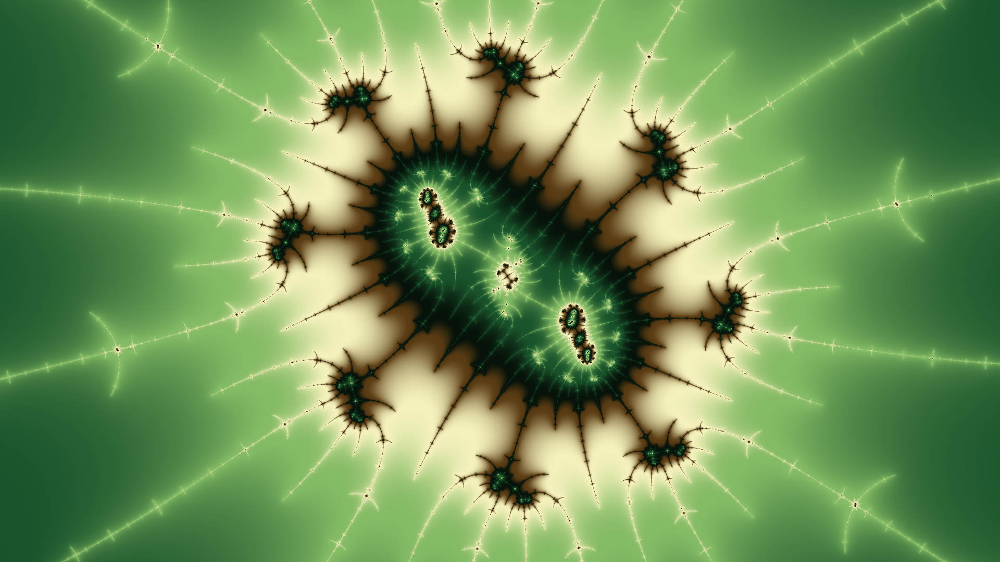
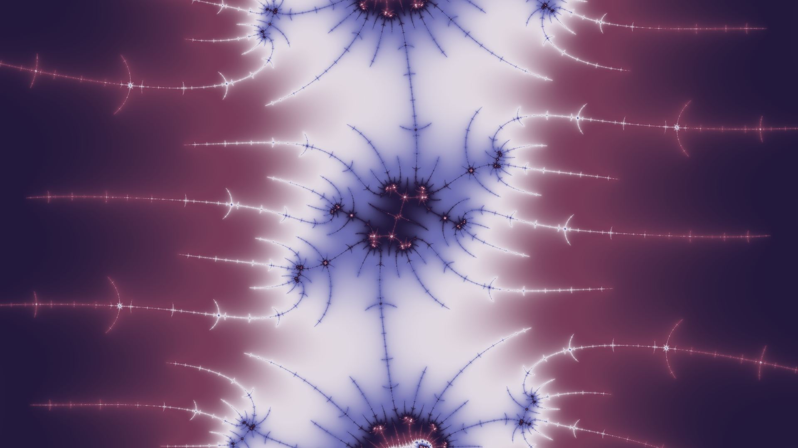
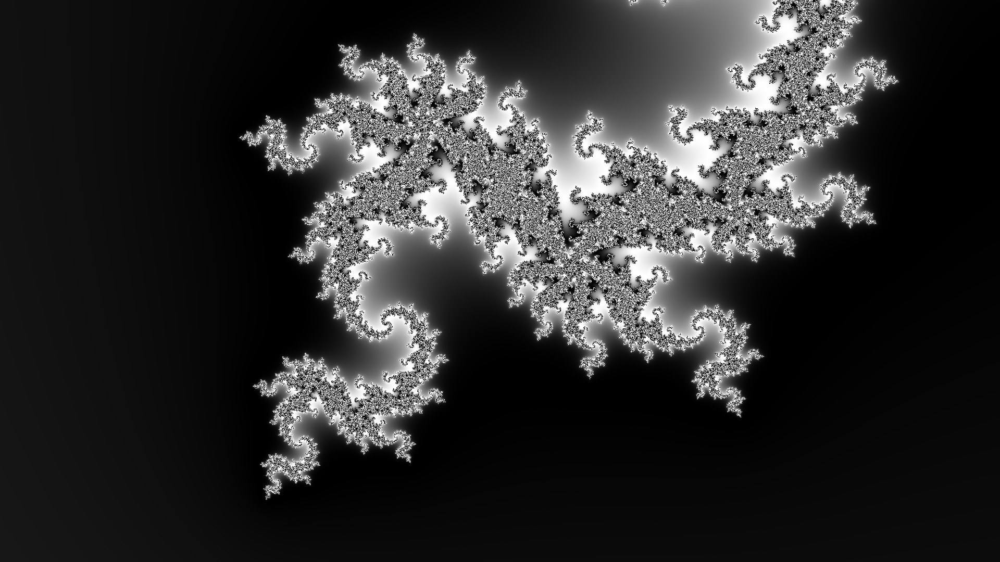

# Mandelbrot Explorer

Deep-zoom fractal explorer in a single self-contained HTML file. WebGL2 rendering,
arbitrary-precision reference computation in a web worker, WebCodecs video export.
No build step, no server, no external dependencies.

## Usage

Open `mandelbrot-explorer.html` in a Chromium-based browser.
Scroll/pinch to zoom, drag to pan, double-click to center, `H` for the help overlay.

## Fractals and limits

| Fractal | Max zoom | Engine |
|---|---|---|
| Mandelbrot | 10²⁹⁰ | GPU perturbation, floatexp past ~10²⁵, BLA |
| Burning Ship, Tricorn | 10²⁵ | GPU perturbation |
| Julia | 10¹³ | GPU perturbation, CPU float64 fallback for lake-anchored views |
| Sierpinski Carpet, Sierpinski Triangle, Koch | 10³⁰ / 10³⁰ / 10⁴ | GPU geometric (exact BigInt prefix walk) |

Iteration limit 100,000. Anti-aliasing 2–4× supersampling. The HUD shows the active
engine: `GPU·pert`, `GPU·pert-fx` (floatexp), `+bla` suffix when skip tables are
active, `GPU·geo`, or `CPU·Nw`.

## Depth

Native floats fail on coordinates past zoom ~10¹³ (float64) — adjacent pixels round
to the same number. The renderer stacks five techniques:

| Technique | Function |
|---|---|
| Arbitrary-precision reference | One orbit per view in BigInt fixed-point (fraction bits scale with depth), computed in a worker. Conversion to float keeps 53 significant bits at any magnitude. |
| Perturbation (K. I. Martin) | Each pixel is an offset δ from the reference; `δ' = 2Zδ + δ² + δc` contains only small or orbit-sized terms, so per-pixel iteration runs in float32 on the GPU. |
| Rebasing (Zhuoran) | When `\|z\| < \|δ\|` or the reference ends, the pixel restarts against iteration 0 of the same reference (exact, since Z₀ = 0). Replaces glitch detection and secondary references; bounds float32 error growth. |
| floatexp | float32 underflows at ~10⁻⁴⁵. A float32 mantissa with a separate exponent extends the range to ~10^±10⁸. A dedicated shader uses it past zoom ~10²⁵ at ~5× per-step cost. |
| BLA (Zhuoran / Fraktaler-3) | While `\|δ\|` is inside a precomputed validity radius, the iteration is linear and merged steps apply as one multiply-add. A binary tree over the reference provides skips of 2–8192 iterations; radii collapse at the orbit's near-zero passes, forcing exact steps exactly where rebasing fires. The deep shader compares radii in log₂ space. |

All numerics were validated against exact BigInt per-pixel iteration in standalone
Node harnesses before shader integration.

## Rendering pipeline

- Interactive GPU frames are paced to measured frame cost; intermediate display
  frames are affine transforms of the last render, keeping motion at display rate.
- Adaptive iteration budget and resolution during motion (FAST mode) or
  full-resolution interactive frames (CRISP mode).
- Final renders above a cost threshold draw in scissored bands through one shared
  canvas transform; a band pass cancels on input.
- A 6×6 float64-perturbation probe measures the actual iteration requirement per
  view and caps the depth heuristic when every probe escapes (Mandelbrot finals only,
  never video frames).
- Reference orbits extend incrementally; orbit and BLA textures rebuild lazily on
  change.
- Video renders continue at full speed in background tabs (worker-based timing).

## Video export

Exponential zoom dives to MP4 (H.264/HEVC), WebM (VP9/AV1) or a lossless PNG
sequence with generated ffmpeg assembly commands. Codec level/tier is selected from
resolution, frame rate and bitrate. At render start the encoder is calibrated: a
burst of incompressible noise runs through candidate configurations
(hardware/software, latency mode, bitrate mode) and the first configuration that
measurably delivers the requested bitrate is used; a shortfall is reported in the
completion message. Renders above ~800 MB stream to disk via the File System Access
API. Optional audio track drives palette shift and brightness pulse from energy,
bass and transient analysis; a depth-weighted focus parameter restricts the reaction
to dense structure. The render dialog previews color and reactivity settings on a
fixed precomputed region.

## State format

Views export as JSON (clipboard or file): decimal-string coordinates, world-space
height and all parameters. States are exact and device-independent.

## Requirements

Chromium-based browser. WebGL2 (rendering), WebCodecs (video), File System Access
API (streamed renders). HEVC/AV1 encoding depend on GPU and OS support.

## Documentation

`engine-notes.html` — interactive companion page explaining the five techniques
with live-computed instruments.

## Credits

Perturbation theory: K. I. Martin (SuperFractalThing). Rebasing and bivariate
linear approximation: Zhuoran. floatexp lineage: Kalles Fraktaler,
Claude Heiland-Allen (Fraktaler-3). Built in collaboration with Claude (Anthropic).
